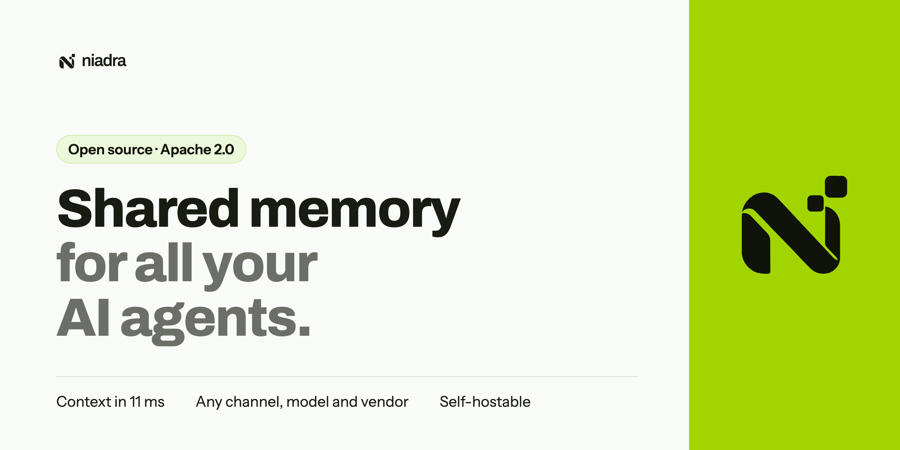

<p align="center">
  <a href="https://niadra.com/en"></a>
</p>

<h1 align="center">Niadra</h1>

<p align="center">
  <b>The open-source memory layer for AI agents that talk to customers.</b><br>
  One memory of each customer, built from every channel and system, read by any agent before its model call.
</p>

<p align="center">
  <a href="LICENSE"></a>
  <a href="https://pypi.org/project/niadra/"></a>
  <a href="https://www.npmjs.com/package/@niadra/sdk"></a>
  <a href="https://github.com/ainiadra/niadra/actions/workflows/server.yml"></a>
  <a href="https://docs.niadra.com/en"></a>
  <a href="https://niadra.com/en/benchmark"></a>
</p>

<p align="center">
  <a href="https://niadra.com/en">Website</a> ·
  <a href="https://docs.niadra.com/en">Documentation</a> ·
  <a href="https://niadra.com/en/benchmark">Benchmark</a> ·
  <a href="https://github.com/ainiadra/niadra-sdk-python">Python SDK</a> ·
  <a href="https://github.com/ainiadra/niadra-sdk-ts">TypeScript SDK</a> ·
  <a href="spec">Open specs</a>
</p>

---

**Niadra** is an open-source, self-hostable **memory layer for AI agents**. It takes the events from
every channel, platform and system (WhatsApp, voice calls, chat, e-mail, the CRM, the ERP, the help
desk), works out which customer each event belongs to, turns conversations into **facts, open items
and promises with the turns that prove them**, and hands any agent, from any vendor or framework, a
short **context before its model call**.

The WhatsApp agent, the voice agent, the billing agent inside the ERP and the human team read the
same memory before they act, and write back what they said and did. Your agents keep their own
models, prompts and vendors. Niadra is the memory they share, and it stays neutral: no vendor reads
another vendor's memory, and no framework owns it.

```text
 WhatsApp · voice · chat · e-mail              ┌──────────── Niadra ────────────┐            any agent, any vendor
 CRM · ERP · help desk · billing   ── events ─▶│ identity · facts · open items │── context ─▶ LangChain · OpenAI Agents
 webhooks · files · your SDK calls             │ business objects · history    │   tools    ▶ LiveKit · Pipecat · Vapi
                                               └──────── one per customer ──────┘    MCP     ▶ CrewAI · ADK · your own code
```

## Why Niadra

A customer tells your WhatsApp agent that order 4471 arrived with a broken lid and that she needs a
replacement by Friday. An hour later she calls, and the voice agent runs on another vendor's
platform. Without a memory that spans both, the voice agent asks her to explain everything again,
and nobody remembers the Friday promise. With Niadra, the voice agent starts the call knowing about
the open replacement and its deadline, and when the billing agent credits her invoice in the ERP,
the other agents see it within seconds.

Most memory libraries assume one agent, one chat and one `user_id` you already know. Real companies
have many agents, many channels, many systems of record and no shared id. Niadra is built for that:

- **Identity across channels.** Ties every event to the right person across phone numbers, e-mails,
  WhatsApp ids and CRM ids, and to the companies that person acts for. You do not pass a shared user id.
- **Context before every model call.** A compiled block of a few lines per agent and per view
  (voice or chat), about 90 tokens per turn at the median, read in **11 ms at p50**.
- **Facts, open items and promises with evidence.** Every derived item keeps the turns that prove it,
  and an item closes when a system of record confirms the action.
- **Business objects and typed state.** Orders, invoices, tickets and lawsuits as the systems of record
  report them, with object types declared or derived from your PostgreSQL schema.
- **The full history on demand.** `search()`, `timeline()` and `open()`, as function-calling tools for
  any model provider and as an **MCP server** bound to one customer.
- **Privacy built in.** Each item carries a verification level and a purpose; what a conversation has
  not proved is held back. Every read leaves a receipt, and a person can be erased or exported on
  request (LGPD and GDPR).
- **Nothing is cut.** Nothing received, stored or learned is truncated or expired. Only the block of one
  read has a size, and it says how much more there is and how to reach it.
- **Defaults over configuration.** Everything is served by default, without per-field setup.
- **It never takes your agent down.** The SDKs have their own time budgets; with Niadra slow or down,
  the agent answers without memory instead of failing.

## Benchmark

Niadra and ten other memory systems (thirteen configurations) were measured on the same dataset of
cross-channel customer conversations, in the same AWS region, with the same agent and the same judge
for every system. The harness, the dataset and every result file are public in
[`niadra-sdk-python/benchmarks`](https://github.com/ainiadra/niadra-sdk-python/tree/main/benchmarks),
so anyone can run it again. Run [`2026-09-30-5ea7a2`](https://github.com/ainiadra/niadra-sdk-python/tree/main/benchmarks/results/2026-09-30-5ea7a2),
accuracy on the same 165 valid cases:

| System | Cross-channel accuracy | Model spend per 1,000 conversations |
|---|---|---|
| **Niadra** (3 repetitions) | **98.7%** | **US$ 0.36** |
| Hindsight | 86.7% | US$ 6.10 |
| Amazon Bedrock AgentCore Memory (3 repetitions) | 80% | US$ 7.50 (AWS list price, its models included) |
| Honcho (dialectic) | 79.4% | US$ 6.92 |
| Mem0 open source (3 repetitions) | 77.6% | US$ 1.88 |
| Memobase | 77% | US$ 4.13 |
| Supermemory local | 71.6% | US$ 5.78 |
| Cognee | 70.3% | US$ 6.95 |
| LangMem | 66.7% | US$ 3.70 |
| Graphiti | 52.8% | US$ 18.72 |
| MemOS | 51.6% | US$ 3.70 |

- **Different id on each channel.** When each channel sends its own user id (agents from different
  vendors), Mem0 drops to 28.5% and AgentCore Memory to 27.9%. Niadra receives the same channel
  handles in every scenario and links them itself.
- **Freshness.** A WhatsApp message is visible to the voice agent in 62.7 ms at p50 with Niadra, against
  1.8 s for Mem0.
- **Privacy.** Sensitive values handed to an unverified conversation: Niadra 0 of 32; Mem0 and AgentCore
  Memory 32 of 32.
- **Where Niadra does not lead.** Ingest acknowledgement against systems that write in the background,
  opening a single history item, history search p95 against LangMem by a few milliseconds, and tokens per
  turn against readers that return answer text.

The benchmark is produced by Niadra; that is why every input and output is public. The full page, with
every metric, is at [niadra.com/benchmark](https://niadra.com/en/benchmark).

## Quickstart

Install an SDK:

```bash
pip install niadra          # Python 3.10+
npm install @niadra/sdk     # Node.js 20+, Deno, Bun, Cloudflare Workers, Vercel Edge
```

Give your agent memory: record the turns, and read the context before the model call.

```python
from niadra import Niadra, phone

niadra = Niadra(channel="whatsapp")  # reads NIADRA_API_KEY and NIADRA_BASE_URL
customer = phone("+5511912345678")

with niadra.conversation("thread-81", subject=customer) as conversation:
    conversation.customer(incoming_text)          # what the customer wrote
    context = conversation.context()              # what this agent needs to know now
    prompt = instructions + "\n\n" + context.system_block + "\n\n" + context.turn_block
    conversation.mark_injected(context)
    reply = your_model(prompt)
    conversation.agent(reply)                     # what the agent answered
```

```ts
import { Niadra, handles } from "@niadra/sdk";

const niadra = new Niadra({ apiKey: process.env.NIADRA_API_KEY });
const convo = niadra.conversation({ subject: handles.phone("+5511987654321"), channel: "whatsapp", conversation_id: "wa-8812" });

convo.customer(inbound.text, { idempotency_key: inbound.id });
const ctx = await convo.context();
convo.markInjected(ctx);
convo.agent(await callModel(instructions + "\n\n" + ctx.text, history, ctx.suffix));
await convo.end();
```

**Try it without a server.** The Python package ships `niadra-mock`, an in-memory emulator of the same API:

```bash
niadra-mock --port 8765
export NIADRA_API_KEY=nia_sk_test_local_mock_k1_mocksecret NIADRA_BASE_URL=http://127.0.0.1:8765
```

**Run the real thing.** Point `NIADRA_BASE_URL` at your own Niadra server ([self-hosting](#self-hosting)).

## Integrations

Every integration wires the same things into the framework's own extension points: the context
before the model call, the turns with the provider's usage, the history tools bound to the customer,
what the platform proves about who is there, and handoffs.

| Kind | Integrations |
|---|---|
| Voice | LiveKit Agents, Pipecat, ElevenLabs Agents, Vapi, Retell AI, Twilio Voice |
| Channels | WhatsApp Cloud API, Twilio SMS and WhatsApp, webhooks, batch and file imports |
| Agent frameworks | OpenAI Agents SDK, LangChain, LangGraph, LlamaIndex, CrewAI, Google ADK, Strands Agents, Pydantic AI, Agno, Microsoft Agent Framework, Semantic Kernel, Haystack, CAMEL-AI, DSPy, AG2 (AutoGen), Vercel AI SDK, Mastra, Genkit, VoltAgent, Cloudflare Agents |
| Model SDKs | OpenAI, Azure OpenAI, Anthropic, Amazon Bedrock, Google GenAI, LiteLLM |
| No-code and automation | Langflow, Dify, n8n, Flowise |
| Protocols | MCP (Model Context Protocol), OpenTelemetry `gen_ai` conventions, the [open specs](spec) |

See the [Python SDK](https://github.com/ainiadra/niadra-sdk-python#integrations) and the
[TypeScript SDK](https://github.com/ainiadra/niadra-sdk-ts) for the full list and one example per integration.

## Self-hosting

Niadra runs on PostgreSQL, RabbitMQ, a Redis-compatible cache and S3-compatible object storage,
plus an OpenAI-compatible model endpoint you configure. No code depends on a proprietary cloud service.

| Path | What it gives you |
|---|---|
| [`deploy/k8s`](deploy/k8s) | The Helm chart and helmfile we run in production on k3s: every deployable, autoscaling on queue depth, PgBouncer, RabbitMQ, Valkey, metrics, alerts, nightly backups |
| [`deploy/aws`](deploy/aws) | The CloudFormation stack of one cell on AWS: network, the machine, PostgreSQL, buckets, keys, logs |
| [`deploy/scripts/local-e2e.sh`](deploy/scripts/local-e2e.sh) | A full cell on one computer for development, with every deployable and its services, and the end-to-end check |

The server reads its configuration from the environment; see [`server/README.md`](server/README.md)
for every variable, including the model endpoints, and [`deploy/README.md`](deploy/README.md) for the
deployment steps.

## How it works

```text
           ┌────────── ingest ──────────┐      ┌───────── workers ─────────┐      ┌────────── read ──────────┐
 events ──▶│ POST /v1/batch, webhooks,  │─────▶│ identity, extraction,     │─────▶│ context(), history,      │──▶ agents
           │ file imports, media        │ queue│ objects, compile packs    │      │ objects, tools, MCP      │
           └────────────────────────────┘      └───────────────────────────┘      └──────────────────────────┘
                                   one PostgreSQL database per customer space, envelope-encrypted
```

One Python codebase, one image, several deployables: `ingest`, `read`, `admin`, `workers`, `loops`,
`insights` and `control`, plus an in-cell models server for embeddings, PII spans and text in images.
Each customer space gets its own PostgreSQL database with its own data key. The read path serves a
pinned, compiled pack that the SDKs cache and revalidate by ETag.

## Repository layout

| Directory | What it is |
|---|---|
| [`server/`](server) | The Niadra server (Python): ingest, read, admin, workers, loops, insights and control, and the models server |
| [`web/`](web) | The website, the Console (the governance UI for a company's spaces) and the small site API |
| [`deploy/`](deploy) | How a cell runs: Helm chart, CloudFormation stack, operator scripts, end-to-end checks |
| [`spec/`](spec) | The open specifications: Event Envelope, Context Pack, Verification Assertion and more, as JSON Schema with test vectors |
| [`docs/`](docs) | The documentation published at [docs.niadra.com](https://docs.niadra.com/en), in English and Portuguese |

The SDKs live in their own repositories: [`niadra-sdk-python`](https://github.com/ainiadra/niadra-sdk-python)
and [`niadra-sdk-ts`](https://github.com/ainiadra/niadra-sdk-ts).

## FAQ

**What is Niadra?**
An open-source memory layer for AI agents. It builds one memory of each customer from every channel,
platform and system, and gives any agent a short context before its model call, plus the full
history as tools and MCP.

**Is Niadra an open-source alternative to Mem0?**
Yes. Both give agents long-term memory; Niadra is built for many agents, channels and vendors sharing
one customer. It resolves identity across channels itself, keeps open items and business objects with
evidence, and enforces verification levels on every read. In the public benchmark above, Niadra scored
98.7% against 77.6% for Mem0 open source, and 28.5% for Mem0 when each channel uses its own id.

**How is it different from storing chat history in a database or a vector store?**
Stored history is raw text for one channel. Niadra keeps derived facts and open items with the turns
that prove them, resolves identity across channels and systems, closes items when a system of record
confirms an action, and filters what each agent may read by the conversation's verification level.

**Can I self-host Niadra?**
Yes. Everything that runs Niadra is in this repository under the Apache 2.0 license: the server, the
Console, the Helm chart, the CloudFormation stack and the operator scripts.

**Which LLM does Niadra need?**
Your agents keep whatever model they use. The server itself extracts facts through an OpenAI-compatible
chat completions endpoint you configure (`NIADRA_LLM_BASE_URL`, `NIADRA_LLM_MODEL`, `NIADRA_LLM_API_KEY`)
and, optionally, asks a decision model endpoint for typed yes-or-no checks (`NIADRA_DECISIONS_BASE_URL`,
`NIADRA_DECISIONS_MODEL`); without it, every check takes its conservative answer. Embeddings and PII
detection run inside the cell, on the bundled models server.

**Does it work with LangChain, LlamaIndex, CrewAI, the OpenAI Agents SDK or voice platforms?**
Yes, with ready-made integrations for more than thirty frameworks, voice platforms, channels and model
SDKs. The context is plain text you place in your prompt, so any model works.

**Does Niadra support MCP?**
Yes. A subject token binds an MCP connection to one customer, so the model can search and open that
customer's history and nothing else.

**What happens if Niadra is slow or down?**
The agent keeps answering without the memory. Every SDK call has its own time budget, retries
included, and returns an empty value instead of raising.

## Contributing

Issues and pull requests are welcome. Read [CONTRIBUTING.md](CONTRIBUTING.md) for how the repository is
organized and how to run each component's checks, and [AGENTS.md](AGENTS.md) if you work with a coding
agent. Report vulnerabilities privately, as [SECURITY.md](SECURITY.md) explains.

## License

[Apache 2.0](LICENSE). The Niadra name and logo are trademarks of Niadra; the license does not grant
rights to use them.
